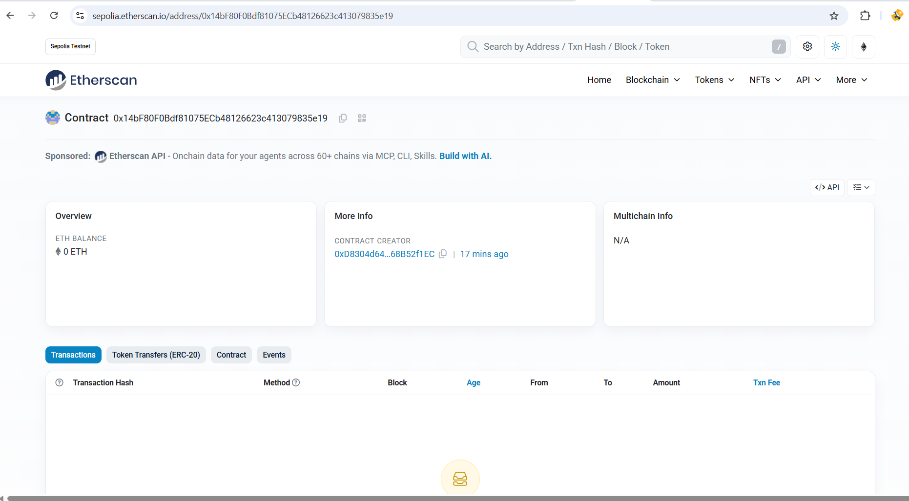
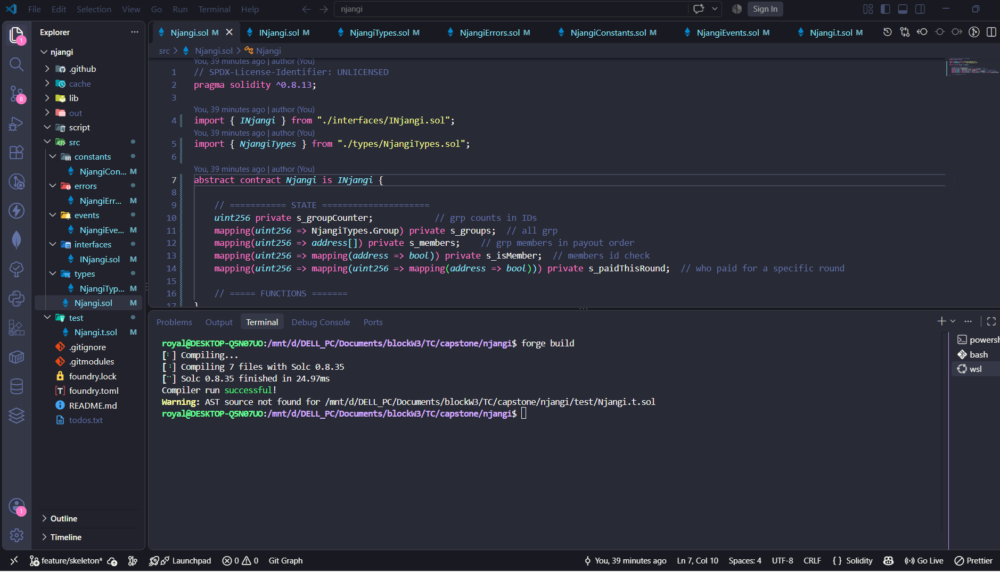
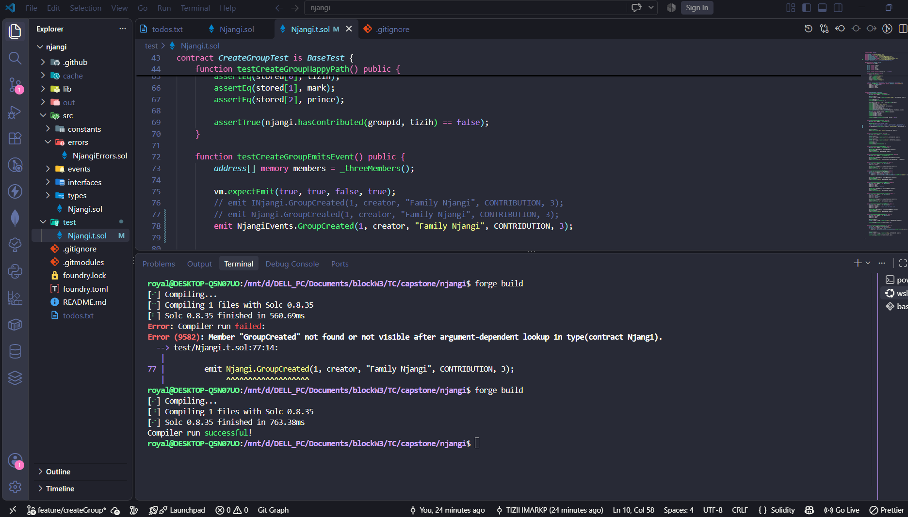
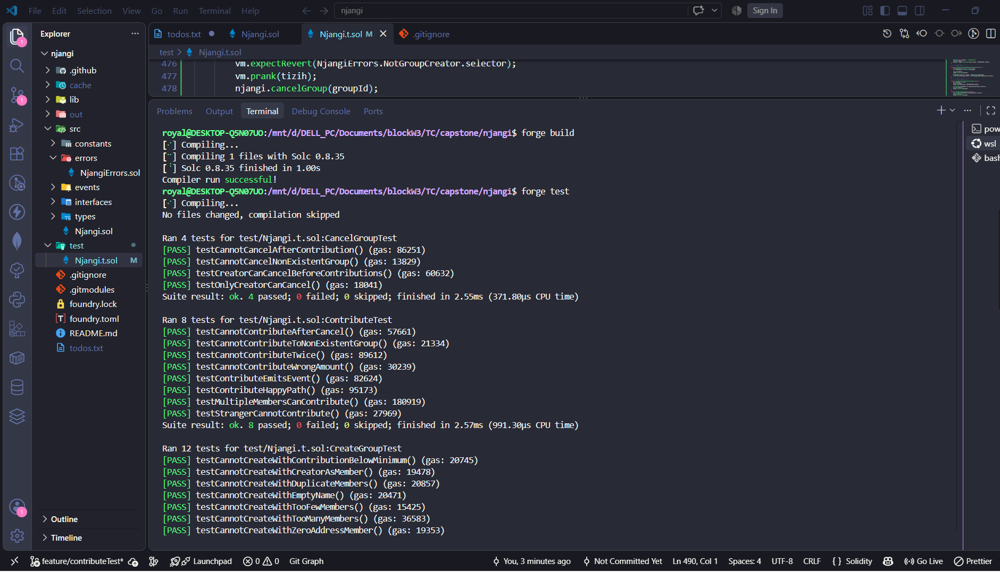
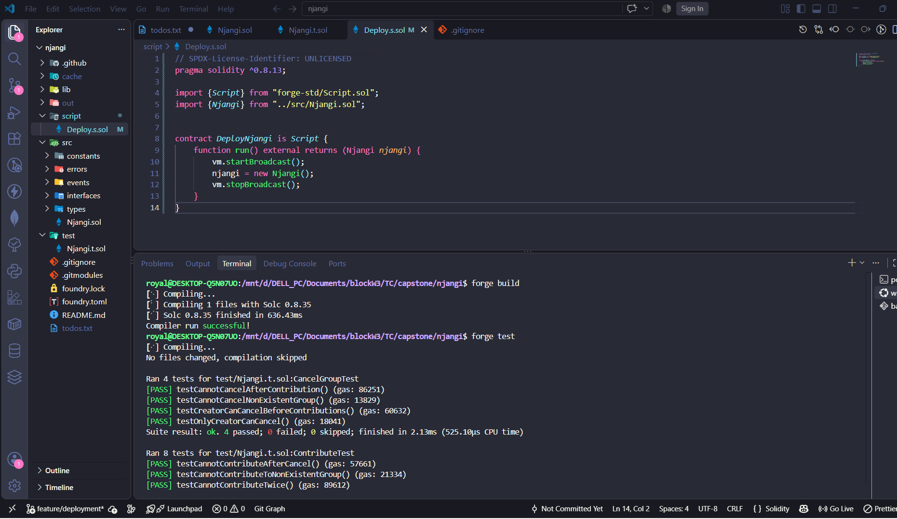
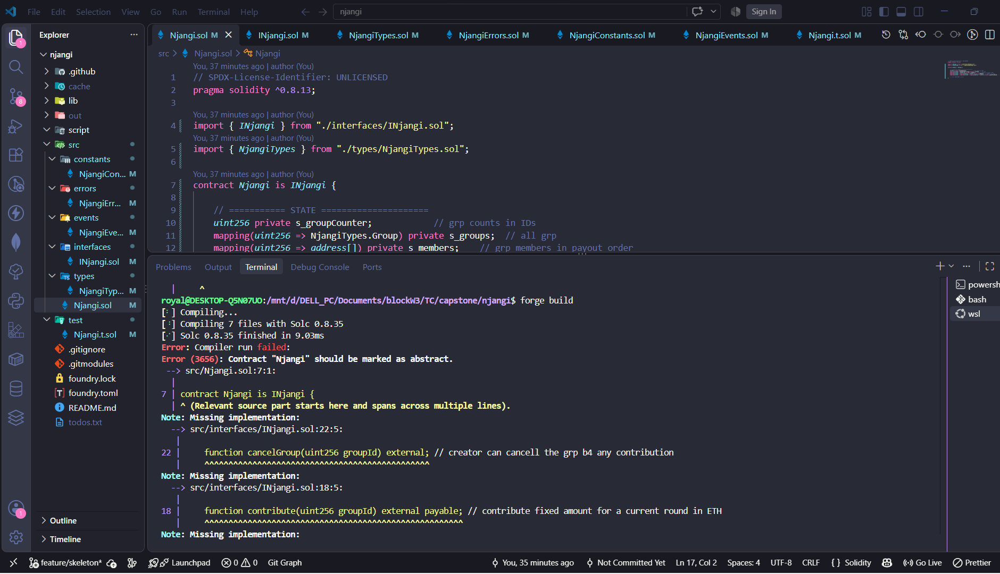
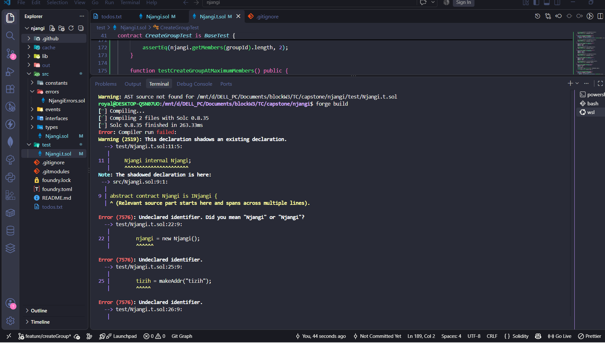
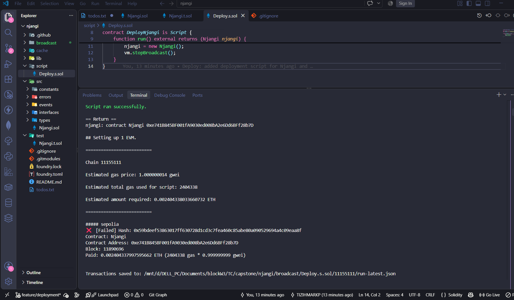

# Njangi Project

A rotating savings and credit association (ROSCA) built on-chain. This is the Njangi system many of us know in Bamenda and across Cameroon, but with the money held by a smart contract instead of a treasurer

The problem we are solving is simple. Every quarter, some Njangi group scatters because one person collects the pot and runs, or the treasurer says the money got lost. In a place where people are always moving and trust is already hard because of the crisis, this kind of thing is painful. The contract takes the treasurer out of the equation. The money is locked, the rotation is automatic, and no one can disappear after carrying Njangi.

This is my stand alone capstone project for TC Web3 development Bootcampt.

---

## How the Njangi Works

A creator sets up a group with a name, a fixed contribution amount, and a list of members in the order they will receive the pot

Every round, each member contributes the exact same amount. When everyone has paid, the full pot goes to the member whose turn it is. Then the next round begins, and the next person in the list receives. This repeats until every member has collected once, and then the group is finished

There is no treasurer. There is no way for anyone to skip out with the money. If someone refuses to pay, the contract simply cannot move forward, and the group has to sort it out the same way a real Njangi group would. That is a decision I made on purpose since a smart contract cannot force a person to pay, so I did not pretend it could

---

## The Functions

Here is what the contract does, in plain terms.

**createGroup**: The creator sets up a new group. They give it a name, choose the contribution amount, and list the members in payout order. The creator cannot also be a member. Members must be unique, and the group must have at least two and no more than twenty of them

**contribute**: A member pays their share for the current round. They must send exactly the contribution amount, and they can only pay once per round. A stranger cannot contribute. A member cannot contribute twice

**payout**: Once every member has contributed for the round, anyone can trigger the payout. The full pot goes to the member whose turn it is. The round advances automatically. When the last member has been paid, the group is marked as completed

**cancelGroup**: The creator can cancel the group before anyone has contributed. Once contributions start, the group cannot be cancelled. This protects members who have already paid in

**View functions**: Anyone can read the group details, the member list, the current round, whose turn it is to receive, and whether a particular member has contributed this round

---

## The Flow

1. Creator deploys the group with the members in payout order
2. Each member contributes the fixed amount for round one
3. Once everyone has paid, payout sends the full pot to the first member
4. Round two begins. Everyone contributes again
5. The pot goes to the second member
6. This repeats until every member has received once
7. The group is then marked as completed automatically

If someone does not pay, the round does not complete, and the payout cannot happen. That is the strict rule I chose, because it matches how real Njangi groups actually work

---

## The Security Choices

Every function that sends ETH uses a reentrancy guard. State is always updated before the transfer happens, following the checks effects interactions pattern

Access control is enforced with modifiers. Only the creator can cancel. Only members can contribute. Only valid states are allowed at each step

The contract uses custom errors instead of require strings which is cheaper on gas and easier to test against

There is no owner or admin role. Once the group is created, the contract runs itself. This was a deliberate choice, because the whole point of the project is to remove the person in the middle thereby making it decentralize as in the actual blockchain world

---

## Future Updates

Things I left out which i would implement in the future:

- Penalties or late fees for missing a contribution
- Kicking out members who do not pay
- Stablecoin contributions instead of ETH, which would make more sense in real life for Cameroon
- A frontend
- Individual deadlines per round

These are all things I know real Njangi groups would need. I would add them as projects updates

---

## The Stack

Solidity 0.8.13
Foundry for building and testing
OpenZeppelin for the reentrancy guard
Sepolia testnet for the deployment

---

## How to Build and Test

1. Install the dependencies first:
`forge install foundry-rs/forge-std`
`forge install OpenZeppelin/openzeppelin-contracts`
2. Then build:
`forge build`
3. Then run the tests: 
`forge test`

All tests pass. The test file covers group creation, contributions, payouts, cancellations, and the revert cases for each of them

---

## Deployment

The contract is deployed on Sepolia.

- Contract Address: 0x14bF80F0Bdf81075ECb48126623c413079835e19
- Etherscan: https://sepolia.etherscan.io/address/0x14bF80F0Bdf81075ECb48126623c413079835e19
- Network: Sepolia
- Deployer: 0xD8304d643FC223f1E086f0B7C5D64Ec68B52f1EC

## Screenshots

**Project structure setup**

**forge build**

**forge test**

**Deployment Script**

**Build Error**

**Create Group Error**

**Deployment Error**

## Project Reflections

Building this made me realise something, a smart contract cannot fix trust. It can only remove one specific person from the equation. If four people agree to save money together, the contract can hold the money and rotate it automatically, but it cannot make them honest or make them pay. That part is still social

That said, the contract solves the part that actually hurts in Njangi today. No treasurer. No one running off with the pot. The rules are the same for everyone, and they are written in code for anybody to read

---

## License

MIT

`Tizih Mark | Web3 Njangi Project`
`October 2026`